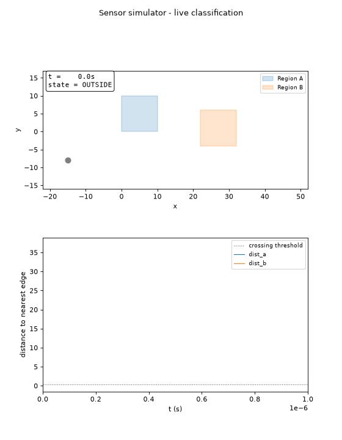

# sensor-sim

Real-time **In A / In B / Outside** classification of a simulated GPS
sensor moving along one axis over time, using nothing but two no-argument
distance readings — `get_dist_a()` and `get_dist_b()` — the way a real GPS
unit's firmware would expose unsigned nearest-boundary distances with no
access to "true" position.

```
t=   42.3s  x= +28.14  dist_a= 28.14  dist_b=  4.86  -> IN B
```



## The problem

A sensor moves continuously along a single axis (X) over time, through a
space containing two regions, A and B. They may be disjoint, merely
adjacent (sharing a bar, as in the packaged default scenario), or
genuinely overlapping (as in `configs/overlap_scenario.yaml`) — all three
are valid configurations. Each region is an interval bounded by two
**bars** — a low edge and a high edge. At any instant you can ask two
things:

- `get_dist_a()` — distance from the sensor to the nearer of Region A's two bars
- `get_dist_b()` — distance from the sensor to the nearer of Region B's two bars

Both are **unsigned** — always `>= 0`, whichever side of the bar the sensor
is on. That is the whole difficulty: a point just inside a region near its
low bar and a point just outside that same bar report the *same* number.
Distance magnitude alone cannot say "inside" or "outside" (see **Design
decisions** below for how this is actually resolved).

The task: classify the sensor's region (`IN_A`, `IN_B`, or `OUTSIDE`) in
real time, as each reading arrives — no buffering a trajectory and
analyzing it afterwards. The classifier always returns a single state;
when A and B overlap and the sensor is in their shared span, Region A
takes priority (see **Design decisions** below).

## Quickstart

```bash
python3 -m venv .venv && source .venv/bin/activate
pip install -e ".[dev]"
```

Run the live demo (opens a matplotlib window with x(t) against both
regions' bars, and the raw distance traces below it; also prints each tick
to the terminal):

```bash
sensor-sim
```

Terminal-only, no plot window (handy over SSH / in CI):

```bash
sensor-sim --no-plot
```

Run a different scenario, faster:

```bash
sensor-sim --config configs/alt_scenario.yaml --realtime-factor 20
```

Run the test suite:

```bash
pytest
```

Or, via the [Makefile](Makefile): `make install` sets up `.venv` and
installs everything above, `make test` / `make lint` / `make typecheck` /
`make check` (all three) run the checks, `make run` / `make run-noplot`
run the demo, and `make clean` removes the venv and caches.

## How it works

```
MotionSimulator  -->  SensorSimulator  -->  RealTimeClassifier  -->  Tick stream
   (true x(t))      get_dist_a()/get_dist_b()    IN_A/IN_B/OUTSIDE        |
                   (noisy unsigned distance)                              v
                                                                  CLI text + LiveView plot
```

| Module | Responsibility |
|---|---|
| [`regions.py`](src/sensor_sim/regions.py) | `Interval`: a region bounded by two bars, with `unsigned_distance(x)` |
| [`config.py`](src/sensor_sim/config.py) | Loads region bars, motion, sensor noise, and classifier thresholds from YAML into typed, validated dataclasses |
| [`motion.py`](src/sensor_sim/motion.py) | `MotionSimulator`: the sensor's *true* position x(t), following a looping route at a non-constant, noisy speed |
| [`sensor.py`](src/sensor_sim/sensor.py) | The `get_dist_a()` / `get_dist_b()` API itself — true unsigned distance plus Gaussian measurement noise, clamped `>= 0` |
| [`classifier.py`](src/sensor_sim/classifier.py) | `RealTimeClassifier`: a Schmitt-trigger crossing detector per region, causal and online |
| [`simulation.py`](src/sensor_sim/simulation.py) | Wires the above into a `Tick` stream (`simulate_ticks`), plus `pace()` for real-time playback |
| [`visualize.py`](src/sensor_sim/visualize.py) | Live matplotlib time-series view, driven one tick at a time |
| [`cli.py`](src/sensor_sim/cli.py) | `sensor-sim` entry point |

### Design decisions

**Crossing detection, not a level check — because the reading has no sign.**
With a *signed* distance, `dist_a < 0` would mean "inside" directly. Here
`get_dist_a()`/`get_dist_b()` only ever report magnitude, so a single
reading is ambiguous: distance `0.2` could be just inside a region's low
bar, or just outside it — the number is identical either way. What *is*
unambiguous is the crossing itself: as the sensor passes through a bar
(from either direction), distance dips to (near) zero and rises again
symmetrically on the other side. `RealTimeClassifier` watches for that dip
and toggles an inside/outside flag per region each time it sees one — a
Schmitt trigger: `crossing_threshold` is how close counts as a crossing,
`rearm_threshold` is how far the reading must recede afterwards before the
*next* crossing can register, which is what stops sensor noise dithering
near one bar from being counted as several crossings. See the extended
rationale — including the honest limitation that a close approach which
turns back without truly crossing is indistinguishable from a real
crossing, given magnitude alone — in the [`classifier.py`](src/sensor_sim/classifier.py)
module docstring. One more honest consequence: Region A and B each get an
*independent* noisy reading from their own, fully independent detector —
`RealTimeClassifier` never looks at region geometry, just the two
booleans `inside_a`/`inside_b`, combined with Region A taking priority if
both are ever true at once — so when A and B are adjacent (the default
scenario), a crossing straight from A into B can very occasionally read as
a one-tick `OUTSIDE` blip if A's exit noise and B's entry noise don't
settle in perfect lockstep — a real artifact of two independent sensors,
not a bug to mask. The same independence is what makes genuinely
overlapping regions (`configs/overlap_scenario.yaml`) work without special
casing: the classifier just reports `IN_A` for as long as the sensor is
inside Region A, overlap or not.

**A narrow region can trap a naive version of this detector.** If a region's
half-width is smaller than `rearm_threshold`, the sensor could be certainly
inside it yet never read far enough from a bar to re-arm — so the detector
would latch "inside" forever and miss the exit crossing. `AppConfig`
validates `rearm_threshold` against both regions' half-widths at load time
and refuses a config where this can happen, rather than failing silently
at run time.

**Variable speed via waypoint-seeking, not a formula over time.** Real GPS
speed isn't `avg_speed` with a single sine wave riding on it — it's
"roughly head towards the next landmark, speeding up and slowing down
along the way." `MotionSimulator` steers towards a looping list of 1D
waypoints while speed oscillates around a configured average with added
Gaussian jitter. This is also what makes the default route reliably pass
through both regions and back again, which a purely random walk would not
guarantee.

**Configuration is data, not constants.** Region bar positions,
motion/noise parameters, and classifier thresholds all live in a YAML file
(`src/sensor_sim/data/default.yaml`, or any file passed via `--config`) and
flow into typed, validated dataclasses in `config.py`. No Python file
contains a bar position or an average speed — changing the scenario never
means editing code. `configs/alt_scenario.yaml` demonstrates this with a
completely different (disjoint-regions) scenario, and
`configs/overlap_scenario.yaml` with an overlapping-regions one.

**Classification is decoupled from display.** `simulate_ticks()` is a plain
generator with no wall-clock sleeping — cheap and deterministic to unit
test. `pace()` is the only place that sleeps, so "run as fast as possible"
(tests, CI) and "run live" (the demo) are the exact same simulation,
consumed two different ways.

**Reads are tick-driven, not clock-driven — a slow consumer can't corrupt
them.** `get_dist_a()`/`get_dist_b()` only ever report the position
`MotionSimulator` currently holds; that position only changes when
something explicitly calls `motion.step(dt)`, which only happens once per
tick inside `simulate_ticks()`'s loop. So if a caller goes quiet for a
while — 6 seconds, a minute, doesn't matter — and then reads again, it
gets the *same* true position (fresh noise aside), never a jump. The only
place wall-clock time enters at all is `pace()`, and even there a stalled
consumer just means `pace()` stops sleeping until it's caught back up to
schedule — every tick still gets delivered, in order, none skipped.

## Configuring a scenario

```yaml
regions:
  A: { low: 0.0, high: 10.0 }
  B: { low: 10.0, high: 20.0 } # side by side with A -- shares A's high bar

classifier:
  crossing_threshold: 0.3   # how close to a bar counts as "crossing" it
  rearm_threshold: 1.5      # must stay below both regions' half-widths
```

Regions may be adjacent (sharing a bar, as in the default scenario above),
have a gap between them (as in `configs/alt_scenario.yaml`), or genuinely
overlap (as in `configs/overlap_scenario.yaml`, where the classifier
reports `IN_A` throughout the shared span, since Region A takes priority)
— all three are valid. `AppConfig` only rejects configs where
`rearm_threshold` isn't small enough for either region's half-width, so a
misconfigured scenario fails fast with a clear error instead of producing
a detector that gets stuck or double-counts crossings at run time.

## Testing

```bash
pytest                 # unit tests: regions, motion, sensor, classifier, config, simulation
ruff check .           # lint
mypy src               # types
```

Notable coverage:
- `Interval.unsigned_distance`: zero at either bar, peaks at the center
  while inside, and — explicitly — equal just inside and just outside the
  same bar (the core ambiguity the classifier has to handle).
- The crossing detector: a full enter → dwell → re-arm → exit cycle,
  that dithering near a bar before re-arming does *not* cause extra
  toggles, and that it is a pure function of `(internal state, reading)` —
  no lookahead.
- The packaged default scenario is asserted to visit all three states
  (`IN_A`, `IN_B`, `OUTSIDE`) over its route, and distance readings are
  asserted to never go negative; `configs/overlap_scenario.yaml` is
  asserted to resolve to a single state throughout, with `IN_A` taking
  priority in the overlap.
- Config validation (missing regions, invalid thresholds, an unreachable
  rearm threshold, non-positive `dt`/`speed_period`/`realtime_factor`,
  negative `duration`/`noise_std`) fails with a clear `ValueError` at
  load time rather than crashing or hanging mid-run; overlapping regions
  are asserted to load without error.
- `pace()`, with a fake clock (no real sleeping): a consumer that stalls
  for several seconds between reads never causes a tick to be skipped,
  and `MotionSimulator`/the sensor API never move or drift just because
  wall-clock time passed without an explicit `step()`.

## Project layout

```
src/sensor_sim/
  regions.py          Interval (a region bounded by two bars)
  config.py           AppConfig and friends, YAML loading + validation
  motion.py           MotionSimulator (true position x(t) over time)
  sensor.py           get_dist_a() / get_dist_b()
  classifier.py       RealTimeClassifier, RegionState (crossing detector)
  simulation.py       simulate_ticks(), pace(), Tick
  visualize.py        LiveView (matplotlib time-series)
  cli.py              sensor-sim entry point
  data/default.yaml   Packaged default scenario
configs/
  alt_scenario.yaml     A disjoint-regions scenario with different bars/noise/thresholds
  overlap_scenario.yaml An overlapping-regions scenario (IN_A takes priority)
tests/
```

## License

MIT, see [LICENSE](LICENSE).
